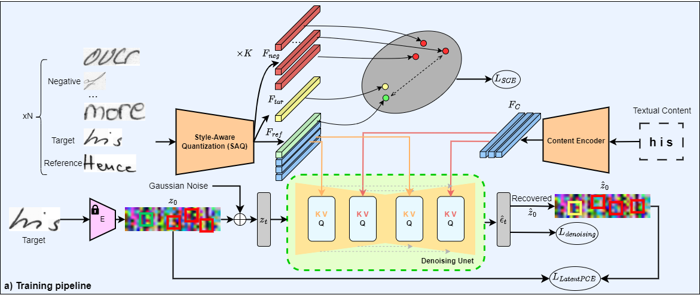
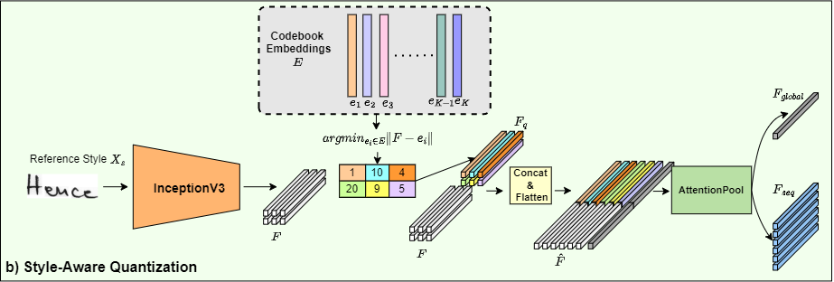
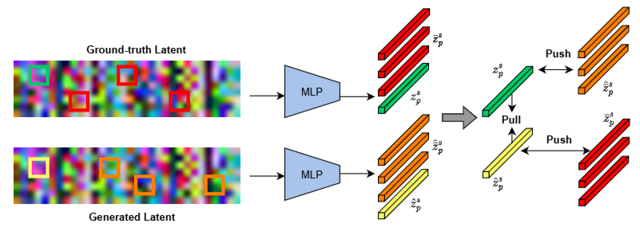
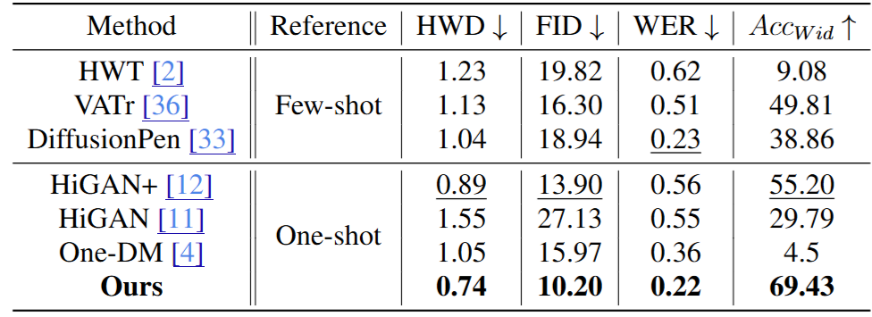
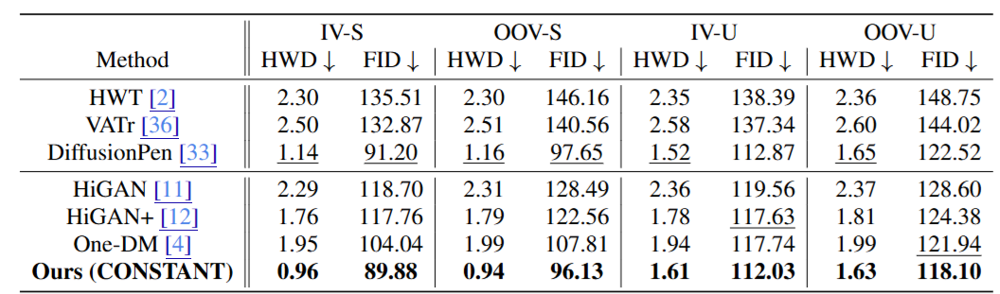
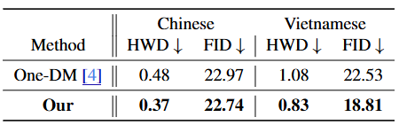
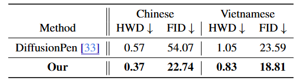
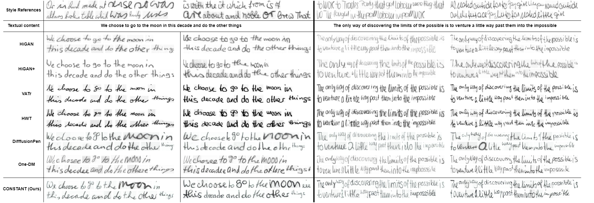
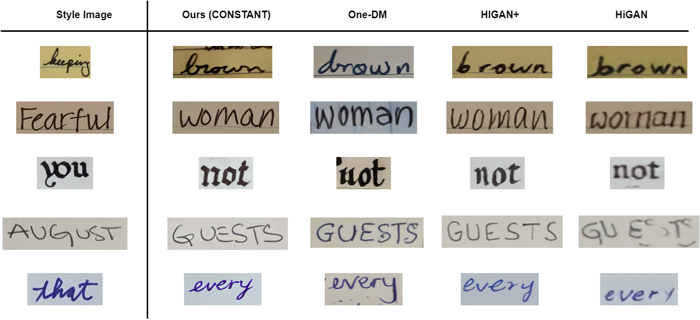
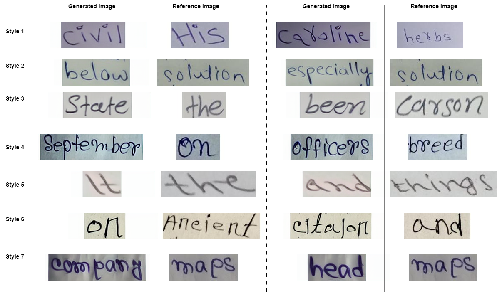

<!-- Using HTML to center the abstract -->
<div class="columns is-centered has-text-centered">
    <div class="column is-four-fifths">
        <h2>Abstract</h2>
        <div class="content has-text-justified">
One-shot styled handwriting image generation, despite achieving impressive results in recent years, remains challenging due to the difficulty in capturing the intricate and diverse characteristics of human handwriting by using solely a single reference image. Existing methods still struggle to generate visually appealing and realistic handwritten images and adapt to complex, unseen writer styles, struggling to isolate invariant style features (e.g., slant, stroke width, curvature) while ignoring irrelevant noise. To tackle this problem, we introduce Patch $\textbf{Con}trastive$ Enhancement and $\textbf{St}yle$-$\textbf{A}ware$ $Qua\textbf{nt}ization$ via Denoising Diffusion ($\textbf{CONSTANT}$), a novel one-shot handwriting generation via diffusion model. CONSTANT leverages three key innovations: 1) a Style-Aware Quantization (SAQ) module that models style as discrete visual tokens capturing distinct concepts; 2) a contrastive objective to ensure these tokens are well-separated and meaningful in the embedding style space; 3) a latent patch-based contrastive ($L_{LatentPCE}$) objective help improving quality and local structures by aligning multiscale spatial patches of generated and real features in latent space. Extensive experiments and analysis on benchmark datasets from multiple languages, including English, Chinese, and our proposed ViHTGen dataset for Vietnamese, demonstrate the superiority of adapting to new reference styles and producing highly detailed images of our method over state-of-the-art approaches
        </div>
    </div>
</div>

---

### **Background**

Handwriting synthesis plays a vital role in assistive technologies, data augmentation for robust authentication, and improving text recognition systems. The "one-shot" approach—generating handwriting from just a single style example—is particularly valuable for real-world applications where users can only provide minimal reference material.

### **Challenge**

Capturing a writer’s unique style (e.g., stroke width, curvature, slant, and ink density) from a single image is extremely difficult. Existing GAN-based methods often produce unrealistic images and suffer from unstable training. Meanwhile, current diffusion models rely on fixed filters that overlook critical features like color and stroke density, or they require impractical "few-shot" references to achieve high quality. Furthermore, standard denoising processes often result in blurry or oversmoothed local details.

### **Key Contributions**

<figure>
  
  <figcaption>Figure 1: Full pipeline of CONSTANT framework.</figcaption>
</figure>


<div align="center" style="white-space: nowrap;">
  <figure style="display: inline-block; width: 40%;">
    
    <figcaption>Figure 2: SAQ architecture.</figcaption>
  </figure>
  <figure style="display: inline-block; width: 40%;">
    
    <figcaption>Figure 3: Latent Patch Contrastive Enhancement objective.</figcaption>
  </figure>
</div>

- **CONSTANT Model**: A novel one-shot handwriting generation framework based on denoising diffusion.

- **Style-Aware Quantization (SAQ)**: A module that represents handwriting as discrete visual tokens ("style concepts"), allowing the model to capture core stylistic traits while ignoring incidental noise.

- **Style Contrastive Enhancement ($L_{SCE}$)**: A training objective that refines the latent space to better distinguish between different writers.

- **Latent Patch Contrastive Enhancement ($L_{LatentPCE}$)**: A multi-scale patch-based objective that aligns generated and target features to sharpen local details and ensure visual consistency.

- **ViHTGen Dataset**: The introduction of a new dataset specifically designed for Vietnamese handwriting generation.

### **Quantitative Results**


<div align="center" style="white-space: nowrap;">
  <figure style="display: inline-block; width: 45%;">
    
  </figure>
  <figure style="display: inline-block; width: 45%;">
    
  </figure>
</div>
**Key Results**:
- **SOTA on IAM (English)**: Achieved state-of-the-art results with a Handwriting Distance (HWD) of 0.74, FID of 10.20, and a Word Error Rate (WER) of 0.22, outperforming both one-shot and few-shot methods.
- **Real-World Performance (IMGUR5K)**: Outperformed existing methods on complex real-world data with an HWD of 0.99 and FID of 11.48.
- **Multilingual Adaptability**: Demonstrated over 10% improvement in HWD scores for Chinese and Vietnamese scripts compared to previous state-of-the-art models like One-DM. 

### **Qualitative Results**
**IAM**

***IMGUR5K**

**English-word-IIT**



**Key Findings**:
- **Precise Style Mimicking**: The model accurately replicates complex stylistic features including ink color, character shapes, and slants.
- **Detail and Readability**: Unlike other methods that struggle with local consistency, CONSTANT generates sharp, legible text with high fidelity to the reference image.
- **Robustness to Complexity**: Successfully handles diverse backgrounds and difficult character shapes in various scripts, including those with complex stroke densities.
- **Localized Attention**: Interpretability analysis shows that the SAQ module focuses precisely on individual character strokes rather than producing diffuse, unfocused attention maps.


## Citation
```
```
